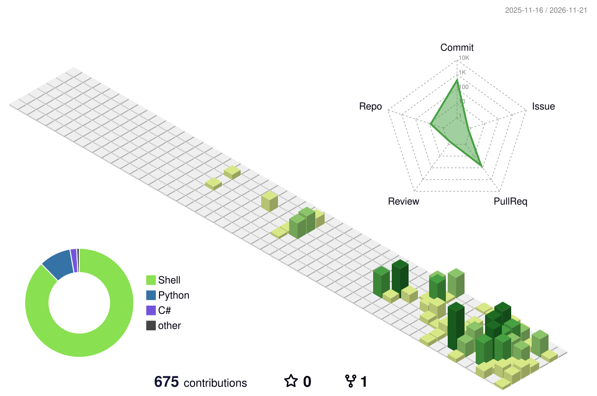

  

  

    
    
    
    
  

---

## 👋 About me

**QA Automation Engineer** with a **DevOps** mindset. I design and build test automation
frameworks with **Cypress** and **Playwright**, cover the API layer, and wire it all into
**CI/CD** so quality gates run on every commit. On the infrastructure side I automate with
**Docker, Kubernetes, Terraform, Jenkins** and **Bash/PowerShell**, mostly on **Linux**.

I like finding the bug nobody else found — and then automating the fix.

- 🔭 **Currently focused on:** QA automation (Cypress / Playwright) and DevOps tooling
- 🌱 **Currently deepening:** Go, Kubernetes, Terraform
- 💬 **Ask me about:** test automation, CI/CD, containers, IaC, Linux, PowerShell/Bash automation
- 📍 **Based in:** Medellín, Colombia

---

## 🧪 QA Automation

## ⚙️ DevOps & Cloud

## 💻 Languages & Tools

)

---

## 📊 GitHub Contributions — 3D

  

## 📈 Stats

  
  

  

## 🔥 Recent activity

  

---

## 🚀 Featured projects

|                                                                                                          |                                                                                                          |
| :------------------------------------------------------------------------------------------------------- | :------------------------------------------------------------------------------------------------------- |
| [**Scripts-DevOps-Practice**](https://github.com/Merxxotas/Scripts-DevOps-Practice)                       | [**finalProjectKubernetesHelmLinkerd**](https://github.com/Merxxotas/finalProjectKubernetesHelmLinkerd)   |
| DevOps automation scripts and event daemons — Bash, PowerShell, Python and Go.                            | Kubernetes, Helm and Linkerd — academy final project.                                                    |
| [**Cypress-Testing**](https://github.com/Merxxotas/Cypress-Testing)                                       | [**PlayWrightTesting**](https://github.com/Merxxotas/PlayWrightTesting)                                   |
| Web test automation with Cypress.                                                                        | Web test automation with Playwright.                                                                     |
| [**terraform-associate_course**](https://github.com/Merxxotas/terraform-associate_course)                 | [**Jenkins-Course-Zero-to-Hero**](https://github.com/Merxxotas/Jenkins-Course-Zero-to-Hero)               |
| Terraform associate exam prep and IaC practice.                                                          | Jenkins CI/CD from zero to hero.                                                                         |

---

## 📫 Get in touch

- ✉️ **Email:** brayan6590@gmail.com
- 💼 **LinkedIn:** [brayan-marin-guirales](https://www.linkedin.com/in/brayan-marin-guirales/)
- 🎮 **Discord:** Merxxotas#6081

  

